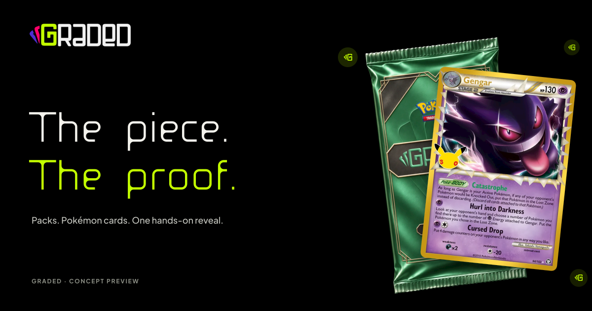

# Graded

**The piece. The proof.**

A public concept preview for Graded’s collectible packs, Pokémon cards, and card marketplace experience.

[Open the live preview](https://gorix-zip.github.io/graded-com-preview/)



## What’s here

- Six Graded pack designs in a rotating selector and a hands-on reveal demo.
- A Pokémon card shelf with card details and an interactive 3D preview.
- Sample card value trends, plus cart and bid-preview interactions.

## Preview limits

This is a concept preview. Market values are illustrative; checkout and bids are not live. Watches, collectibles, vault, and bank features are not available in this build. Pokémon card and pack artwork is included for preview purposes; commercial usage rights are not confirmed.

## Run locally

From this directory, start a static server:

```sh
python3 -m http.server 8942
```

Then open <http://localhost:8942/>.

The site is buildless HTML, CSS, and JavaScript. GitHub Pages serves the `gh-pages` branch.
